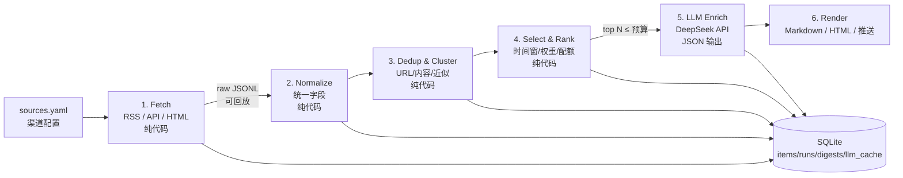

# AI 新闻日报 Agent — 架构设计（v0.1 讨论稿）

> 目标：定时从多个渠道抓取新闻（**纯代码，不涉及 LLM 爬取**）→ 清洗、去重 → 规则筛选 → 调 LLM API 把标题整理成中文并呈现 → 生成日报。
> 状态：设计稿。确认技术栈 / 呈现渠道 / 来源后进入 M0 开发。

---

## 0. 一页看懂



**三条铁律**

1. **LLM 不碰网络**：抓取全部由确定性代码完成，LLM 的输入永远是 fetch 层产出的结构化字段。这样抓取可测试、可复现、可回放。
2. **阶段可独立重跑**：每个阶段的输入/输出都是 JSONL 或 SQLite 行。调试去重只重跑去重，换 prompt 只重跑 enrich，不重新爬。
3. **永远有产出**：LLM 超时 / 超预算 / 返回坏 JSON 时，降级为「原始标题 + 链接」的日报；抓取阶段单源失败不影响整体。

**成本量级**（按 2026-10 的 DeepSeek 价格量级估算，见 §3.5）：每天 15 条日报约 6–8k 输入 token + 1–2k 输出 token，单次成本约 $0.002，一个月不到 1 元人民币。**成本不是瓶颈，去重、排序质量、稳定性才是。**

---

## 1. 目标与非目标

### MVP 目标
- 多来源：RSS/Atom（主力）、JSON API（GDELT / Hacker News / 聚合 API）、静态 HTML（兜底）。
- 无人值守：每天定时跑一次；手动 `run` 也可随时出日报。
- 中文呈现：英文标题翻译/改写为中文标题，一句话摘要，按主题分组。
- 幂等：同一天重跑结果可覆盖，重复新闻不重复展示。
- 可观测：每阶段计数、耗时、失败源、LLM token 用量都有记录。

### 明确不做（MVP 非目标）
- 不用 LLM 驱动抓取 / 浏览器代理（用户已明确要求）。
- 不做全文阅读器、不做站内搜索、不做多用户订阅。
- 不对外发布抓取内容：日报只含「标题 + 短摘要 + 原文链接」。

---

## 2. 总体设计

```
                         ┌──────────────────── 配置文件（config/） ───────────────────┐
                         │ sources.yaml  topics.yaml  prompts/enrich_v1.md          │
                         └──────────────────────────────┬────────────────────────────┘
                                                        │
  ┌─────────┐   ┌────────────┐   ┌──────────────┐   ┌──────────────┐   ┌───────────────┐   ┌───────────┐
  │ 1 Fetch │──▶│ 2 Normalize│──▶│ 3 Dedup/     │──▶│ 4 Select &   │──▶│ 5 LLM Enrich  │──▶│ 6 Render  │
  │ 渠道适配 │   │ 统一 schema│   │   Cluster    │   │   Rank       │   │  DeepSeek API │   │ + 推送     │
  └────┬────┘   └─────┬──────┘   └──────┬───────┘   └──────┬───────┘   └───────┬───────┘   └─────┬─────┘
       │              │                 │                  │                   │                 │
   raw/*.jsonl     items 表          clusters 表        selected JSONL      enriched JSONL     digest.md/html
       │              │                 │                  │                   │                 │
       └──────────────┴───────── SQLite（可回放、可断点、可对账） ─────────────┴─────────────────┘
```

扩展点只有三个，加东西不用改管线：

| 扩展点 | 接口 | 例子 |
|---|---|---|
| **SourceAdapter** | `fetch(ctx) -> list[RawItem]` | 新增渠道 = 加一条 yaml 或一个 adapter 类 |
| **Enricher** | `enrich(items) -> list[EnrichedItem]` | 换模型 / 换 prompt / 加分类标签 |
| **Renderer** | `render(digest) -> Path` | Markdown / HTML / 邮件 / IM 推送 |

---

## 3. 阶段详解

### 3.1 Fetch —— 渠道适配（纯代码）

统一 `Source` 协议，按类型分三个 adapter：

| 类型 | 实现 | 适用 |
|---|---|---|
| `rss` | feedparser（或 stdlib `xml.etree`） | 绝大多数媒体/博客，**首选，实时且免 key** |
| `api` | 声明式：URL、params、headers、JSON 字段映射、分页 | GDELT、Hacker News、NewsData/GNews 等 |
| `html` | httpx 抓列表页 + CSS selector；正文抽取可选 trafilatura | 无 RSS 的站点，MVP 只取标题/链接/时间 |

**HTTP 层统一实现**（`http.py`）：
- UA 标识、超时（连接 10s / 读取 30s）、指数退避重试（3 次）、每域名并发 ≤2、请求间隔 ≥1s；
- 条件请求 `ETag` / `If-Modified-Since`，内容未变不重复入库；
- 307/308、gzip、编码异常兜底；
- 每次抓取的原始条目写 `data/raw/<source>/<run_ts>.jsonl`，**回放和排障都靠它**；
- 单源异常隔离：记 `runs.errors`，其余源照常。

`config/sources.yaml` 示例：

```yaml
sources:
  - id: hackernews
    type: rss
    url: https://hnrss.org/frontpage
    weight: 1.0
    topics: [tech]
    max_items: 30

  - id: gdelt-ai
    type: api
    url: https://api.gdeltproject.org/api/v2/doc/doc
    params:
      query: '"artificial intelligence" sourcelang:english'
      mode: artlist
      format: json
      timespan: 1d
      maxrecords: 50
    map: { items: "articles", title: "title", url: "url", published: "seendate" }
    weight: 0.8

  - id: some-site
    type: html
    url: https://example.com/news
    list_selector: "article a.headline"
    weight: 0.6
```

**来源渠道建议**（按越靠前越优先）：
0. **厂商官方发布**（模型/产品公告）：GitHub releases、HuggingFace 模型、官方博客/文档 changelog、RSS。已对**中美 20 家**（OpenAI、Anthropic、Google、Meta、xAI、Microsoft、Mistral、Amazon、NVIDIA、Cohere、Perplexity、Ai2、Hugging Face + 国内 DeepSeek、Kimi、GLM、Qwen、StepFun、Hunyuan、MiMo）逐一实测，逐家渠道矩阵与推荐 adapter 见 [OFFICIAL_SOURCES.md](OFFICIAL_SOURCES.md)。
1. RSS：BBC、Guardian、AP、Reuters、Ars Technica、TechCrunch、Hacker News；中文：36 氪、虎嗅、少数派、InfoQ 中文、机器之心、量子位等（很多可直接 RSS，或用 RSSHub 生成）。
2. 免 key API：GDELT DOC 2.0（全球多语种）、Hacker News、Spaceflight News。
3. 有免费额度的 API：NewsData.io（200 credits/天）、GNews（100 请求/天）、NewsAPI（100/天，仅开发测试）、Guardian（500/天，含正文）。
4. HTML 兜底：只抓列表页标题+链接，不做全文，降低版权和反爬风险。

> 注意：免费聚合 API 常带 12–24h 延迟和非商用条款；**RSS 是免费、实时、最稳的路径**，聚合 API 作为补充。

### 3.1.1 微博 / 微信公众号渠道可行性（2026-11-08 实测）

| 渠道 | 匿名可抓 | 实测结果 | 稳定性 | 结论 |
|---|---|---|---|---|
| **微博热搜榜** | ✅ 是 | `weibo.com/ajax/side/hotSearch` 返回 200 + 50 条实时热搜（含热度值） | 高（零登录） | **可直接接入**，作为「微博热点」源 |
| 微博指定账号时间线 | ❌ 需登录 | `m.weibo.cn` 与 `weibo.com/ajax/statuses/mymblog` 均返回 `ok:-100` 跳登录；自己构造访客 cookie 也无效 | 低（登录态易失效/风控） | 不做核心源；要做需配置登录 cookie 或 RSSHub 自建，风险自担 |
| 微博关键词搜索 | ❌ 需登录 | 同上 | 低 | 同上 |
| 微信公众号（订阅式 / 全部历史） | ❌ 基本不可行 | 无公开列表/API；搜狗只能按关键词搜且结果不全 | — | 直接爬不现实；走第三方或投喂 |
| **微信公众号（关键词检索 + 正文）** | ⚠️ 目前可行 | 搜狗微信搜索返回 20 条结果；解析跳转页 JS 可还原 `mp.weixin.qq.com` 真实链接；实测成功抓取新华社文章全文（`rich_media_content`，3.4MB HTML） | 中低（反爬会升级，需要限速/重试/换会话） | 可做「关键词监控」补充源，**不能当订阅源**；低频 + 失败降级 |
| 公众号 RSS（wechat2rss 私有部署） | ⚠️ 付费 | 官方文档：¥150/年、任意公众号、24h 内更新（平均 6h）、个人学习用途 | 中（微信风控可能限号） | **必须跟特定号**时最现实的方案 |
| 半自动投喂 | ✅ | 用户把文章链接转发到邮箱/TG/本地文件，管线只解析链接 + 标题 | 高 | 最稳最合规，MVP 预留 |

**建议的接入策略**

- **MVP**：把 **微博热搜** 作为可选源（`weibo_hot` adapter，一次 GET、零登录），日报里单列「微博热点」一节；公众号先不接。
- **只关心少数公众号更新**：接 `wechat2rss` 输出的 RSS（标准 `rss` adapter，零代码），或做「投喂」adapter（读一个链接清单/邮箱）。
- **要做公众号关键词监控**：`sogou_wechat` adapter，低频（每天 1–2 轮、每关键词 ≤1 页、轮间随机延时 3–10s），命中反爬就标记 `blocked` 并跳过当天重试。
- 这两个渠道「抓得越勤坏得越快」，应做成**默认关闭、按需打开**，与 RSS 源分开调度。
- 已有现成实现可参考：开源项目 [dsh-wechat-mp-search](https://github.com/iTraceur/dsh-wechat-mp-search)（MIT，搜狗检索 + 正文抓取，含会话 cookie、限速抖动、反爬重试；同时提供 MCP server 形态），可以直接借鉴其链接还原与反爬策略。

**合规提醒**：微博/微信用户协议都限制未经许可的自动化抓取；搜狗跳转链属于绕开其访问限制的做法，仅建议个人低频、研究用途使用——不商用、不分发全文，只保留标题 + 短摘要 + 原文链接。

### 3.2 Normalize —— 统一字段（纯代码）

```python
class Item(BaseModel):
    id: str            # 稳定 ID：hash(source_id + canonical_url) 或 source+guid
    source_id: str
    source_name: str
    url: str
    canonical_url: str # 去 utm_* / ref / fbclid，去尾斜杠，统一小写域名
    title: str         # HTML 反转义、去空白、去站点后缀（" - 36氪"）
    summary: str | None
    body: str | None   # 可选，MVP 不用全文
    published_at: datetime | None
    first_seen_at: datetime   # 我们第一次抓到这个 URL/内容的时间（UTC）
    last_seen_at: datetime    # 最近一次在源站看到它的时间
    fetched_at: datetime
    lang: str
    content_hash: str  # title+summary+url 的 sha1
    simhash: int       # 标题/摘要的 64 位 SimHash
```

要点：时间解析用 dateutil（RSS 时间格式很乱，缺失时用 fetched_at 兜底）；语言识别用轻量启发式（中文字符占比）即可。

**7 天时效闸门（强制）**：入库前统一卡 `published_at ∈ [now-7d, now]`；无日期源（部分 RSS/列表页）用 `first_seen_at` 兜底；`published_at > now + 1h` 视为异常（changelog 里的“模型下线日期”不是发布时间），拒绝或回退 first_seen。保留/展示规则、轮询分级与实测数据见 [FRESHNESS.md](FRESHNESS.md)。

### 3.3 Dedup & Cluster —— 三层去重（纯代码）

| 层 | 规则 | 目的 |
|---|---|---|
| 精确 | `canonical_url` 相同 / `content_hash` 相同 | 同一篇文章重复抓取 |
| 近似 | `simhash` 汉明距离 ≤3，或标题 token Jaccard ≥0.8 | 同一文章不同 URL / 转载 |
| 聚类 | 同事件跨源：标题相似 + 时间窗 24h + 实体/关键词重叠 | 一条新闻来自 5 家媒体只展示一次 |

聚类产物：`cluster_id` + `sources` 列表。**多源出现次数**直接作为后续排序的“热度”信号。MVP 用规则聚类即可，LLM 二次确认属于增强项。

### 3.4 Select & Rank —— 规则筛选（纯代码）

- 硬过滤：`published_at` 落在 **7 天窗口**（`max_age_days=7`，见 [FRESHNESS.md](FRESHNESS.md)）、语言白名单、域名黑名单（广告/低质站）、**已展示过的不再重复**（`digest_items` 记录 item_id，7 天内同一条只出现一次）；
- 板块分类（已实现）：LLM 把候选分为 **tech / finance / policy** 三个板块，按 `digest.section_quotas`（默认 12 / 5 / 5）精选，板块不足时从其他板块补足；
- 展示窗口 = **7 天排名**（已确认）：日报在 7d 窗口内按 score 取 top N，同一内容只出现一次（`digest_items`）；低频渠道 7 天内没有新内容属正常，不强行凑数；
- 打分：`score = source_weight × recency × 热度(多源数) × 主题关键词命中`；
- 配额：总数 ≤ N（默认 15–20），单源 ≤ M（默认 3），保证多样性；
- **预算裁剪**：总字符数 ≤ 阈值（如 40k chars），给 LLM 留出余量。LLM 的输入预算在这里被卡死，而不是靠 prompt 里说“别太长”。

> 原则：**先用规则把 90% 的噪音干掉，再让 LLM 处理最后的 10%**。不要拿 LLM 当过滤器，贵且不可控。

### 3.5 LLM Enrich —— 语义整理（唯一调用 LLM 的阶段）

**调用参数**
- Endpoint：OpenAI 兼容 `https://api.deepseek.com`；模型默认 `deepseek-flash`（快、便宜），重点条目可切 `deepseek-v4-pro`；
- 也可用 Anthropic 兼容端点 `https://api.deepseek.com/anthropic`（不必，MVP 用 OpenAI SDK 最省事）；
- `response_format={"type": "json_object"}` 强制 JSON；prompt 里必须出现 "json" 字样并给输出示例（[DeepSeek JSON Output 文档](https://api-docs.deepseek.com/guides/json_mode/)）；
- **关闭 thinking**：`extra_body={"thinking": {"type": "disabled"}}`。实测同一条标题改写：关闭时 24 个输出 token，默认开启时 96 个（其中 70 个是 reasoning）；`max_tokens` 太小时 reasoning 会吃掉全部额度，`content` 返回空串且不报错（`finish_reason=stop`）。标题抽取/改写不需要思考链，关掉既省钱又稳定。
- `temperature=0.2–0.3`，`max_tokens` 按批大小设置（每条约 60–100 输出 token，另留余量）；
- 每批 8–15 条，批太大容易截断且坏一条损失一批。

**输入（第二阶段契约）**
```json
{"items": [
  {"id": "a1b2c3", "title": "OpenAI releases ...", "source": "TechCrunch",
   "published_at": "2026-11-08T09:12:00Z", "summary": "OpenAI on Friday announced ..."}
]}
```

**输出（严格校验）**
```json
{"items": [
  {"id": "a1b2c3",
   "title_zh": "OpenAI 发布新一代模型，主打更低延迟",
   "summary_zh": "新模型在推理速度上提升约 40%，API 价格不变。",
   "topic": "AI",
   "importance": 4,
   "duplicate_of": null}
]}
```

**校验与降级链**（重要）
1. `json.loads` → Pydantic 逐条校验；`id` 不在本批输入中的条目直接丢弃；
2. 漏掉的条目补一次“只补缺失 id”的重试；仍失败则回退原文标题；
3. `content` 为空/被截断（DeepSeek JSON 模式可能把非法内容替换成空格，`finish_reason` 仍是 stop）→ 重试一次，再失败整批降级；
4. 任何一步失败都不阻塞：`digest` 用原文标题生成，标记 `degraded: true`。

**缓存与成本**
- 缓存 key = `sha256(prompt_version + model + 输入 JSON)`，命中直接复用，重跑不重复计费；
- 每条 `llm_calls` 记录 model、in/out tokens、缓存命中、耗时、成本估算；
- 每日预算上限（如 2M tokens/天，远超实际需要），超限时只处理 importance 前 N 条；
- **prompt 前缀稳定**（system + schema + few-shot 放最前，新闻内容放最后）：DeepSeek 的上下文缓存命中价约为未命中的 1/50，稳定前缀能实打实省钱。

**成本估算**（deepseek-flash 参考价：cache-miss 输入 $0.15/M、输出 $0.60/M，峰时翻倍；[第三方 2026-10 整理](https://www.activepieces.com/blog/deepseek-api-pricing-2026-cost-per-1m-tokens)）：
- 一天一次（关闭 thinking）：输入 ~7k tokens ≈ $0.001，输出 ~1k tokens ≈ $0.0006 → **约 $0.002/天，每天跑 10 次也不到 10 元/月**。实测单条改写 24 个输出 token；开 thinking 约 96 个，纯浪费。

### 3.6 Render & Deliver —— 呈现（纯代码）

- **Markdown 日报**（主产物）：按主题分组，每条 `**中文标题**（来源 · 时间）` + 一行摘要 + 原文链接；
- **HTML**：Jinja2 渲染单文件，可离线打开、手机能看；
- **推送（可选）**：SMTP 邮件 / Telegram Bot / 飞书、企业微信 webhook（做成 Renderer 插件，配置开关）；
- 归档：`out/2026-11-08/digest.md`、`digest.html`；`digests` 表记录模型、prompt 版本、token 数、是否降级。

### 3.7 市场与投资层（可选，M5）

在 enrich 之后增加「Market Join（事件→公司→标的→行情/财报）」和「Analysis（事件研究 / AI 叙事指数 / SOTP 估值拆分 / 私有公司估值追踪）」两步；Render 增加「AI 资本 & 股价」板块。

数据源已实测：Yahoo Finance（美股日线）、东方财富（港股/A 股行情与公告）、SEC EDGAR（filings、XBRL 财务、8-K Atom、Form D）、HKEX（港股官方公告，待接）；SPCX、META、GOOGL、02513.HK（智谱）、00100.HK（MiniMax）都能取到价格与公告。

核心方法：用市场模型算 AI 事件的 CAR（超额收益），用 XBRL/财报拆 AI 代理指标，再用 SOTP 算「市场隐含 AI 价值」。详见 [MARKET_INVESTMENT.md](MARKET_INVESTMENT.md)。

---

## 4. 数据模型（SQLite，WAL 模式）

```sql
CREATE TABLE sources (      -- 渠道配置快照（配置文件的镜像，方便回溯）
  id TEXT PRIMARY KEY, type TEXT, url TEXT, weight REAL, enabled INTEGER, config_json TEXT);

CREATE TABLE runs (         -- 每次运行的 manifest
  id TEXT PRIMARY KEY, started_at TEXT, finished_at TEXT,
  stats_json TEXT, errors_json TEXT);

CREATE TABLE items (        -- 归一化后的新闻条目
  id TEXT PRIMARY KEY, run_id TEXT, source_id TEXT,
  url TEXT, canonical_url TEXT, title TEXT, summary TEXT,
  published_at TEXT, first_seen_at TEXT, last_seen_at TEXT, fetched_at TEXT, lang TEXT,
  content_hash TEXT, simhash INTEGER, cluster_id TEXT,
  section_hint TEXT,        -- tech / finance / policy（来源提示，LLM 可覆盖）
  expired INTEGER DEFAULT 0);

CREATE TABLE digest_items ( -- 已展示记录：7d 窗口内同一内容只出现一次
  digest_id TEXT, item_id TEXT, shown_at TEXT,
  PRIMARY KEY (digest_id, item_id));

CREATE TABLE clusters (     -- 跨源聚类
  id TEXT PRIMARY KEY, rep_item_id TEXT, item_ids_json TEXT, source_count INTEGER);

CREATE TABLE digests (      -- 每次日报
  id TEXT PRIMARY KEY, digest_date TEXT, window_hours INTEGER, item_count INTEGER,
  model TEXT, prompt_version TEXT, degraded INTEGER,
  markdown_path TEXT, html_path TEXT, tokens_in INTEGER, tokens_out INTEGER, created_at TEXT);

CREATE TABLE llm_calls (    -- 可对账的调用记录
  id INTEGER PRIMARY KEY AUTOINCREMENT, digest_id TEXT, model TEXT, request_hash TEXT,
  cached INTEGER, tokens_in INTEGER, tokens_out INTEGER, latency_ms INTEGER,
  cost_usd REAL, status TEXT, created_at TEXT);

CREATE TABLE llm_cache (    -- 语义缓存
  cache_key TEXT PRIMARY KEY, response_json TEXT, created_at TEXT);

CREATE INDEX idx_items_pub ON items(published_at);
CREATE INDEX idx_items_first_seen ON items(first_seen_at);
CREATE INDEX idx_items_cluster ON items(cluster_id);
```

---

## 5. 目录结构

```
AI News Agent/
├─ .env.example / .env          # LLM_API_KEY 等（.env 不入库）
├─ config/
│  ├─ sources.yaml              # 渠道清单
│  ├─ topics.yaml               # 主题、关键词、配额、黑名单
│  └─ prompts/enrich_v1.md      # prompt 版本化
├─ src/newsagent/
│  ├─ __main__.py / cli.py      # typer CLI
│  ├─ pipeline.py               # 阶段编排（run_id、断点、降级）
│  ├─ models.py                 # Pydantic schema
│  ├─ config.py
│  ├─ http.py                   # httpx 客户端：重试/限速/条件请求
│  ├─ fetch/{base,rss,api,html}.py
│  ├─ normalize.py
│  ├─ dedupe.py
│  ├─ select.py
│  ├─ enrich.py                 # LLM 调用 + 校验 + 缓存
│  ├─ render/{markdown.py,html.py,push.py}
│  └─ store/{db.py,schema.sql}
├─ tests/
│  ├─ fixtures/                 # 真实 RSS/API 返回样本
│  └─ test_{normalize,dedupe,select,enrich,render}.py
├─ data/                        # sqlite、raw（gitignore）
├─ out/                         # digest 输出
├─ tools/sitecustomize.py       # 本机沙箱 pip 兼容 shim（见附录 B）
└─ pyproject.toml
```

---

## 6. 运行方式与工程保障

**CLI（Typer）**
```bash
python -m newsagent run --hours 24 --top 15      # 全流程
python -m newsagent fetch --source hackernews    # 单源抓取
python -m newsagent digest --date 2026-11-08 --no-llm   # 跳过 LLM 出原始日报
python -m newsagent replay data/raw/20261108T0600.jsonl # 回放，不重新抓
python -m newsagent doctor                       # 检查源可用性、key、余额
```

**调度（二选一）**
- Windows 任务计划程序 / cron 每天 07:30 跑 `run`（最省事）；
- 或 APScheduler 常驻进程（要额外守护，MVP 不必）。
- 开机补跑：任务计划勾“如果错过，尽快启动”；`run` 按 `digest_date` 幂等，重复执行只覆盖当天日报。

**幂等 & 回放**
- `items.id` 确定性生成，`INSERT OR REPLACE`；
- 原始响应落盘 → 抓取 bug、换去重算法都能用同一份数据复现；
- 每天重跑覆盖 `out/<date>/` 和 `digests` 行。

**测试**
- 解析器：用 `tests/fixtures/` 里的真实响应做 golden test；
- 管线：注入 fake LLM，验证 id 对齐、坏 JSON、超时三种降级路径；
- 渲染：golden markdown 快照比对。

**观测**
- 每阶段 `log.info(stage=..., in=..., out=..., ms=...)`；
- `runs` 表 + `logs/run-<ts>.jsonl` 可回答“今天为什么只有 3 条”。

---

## 7. 风险与对策

| 风险 | 对策 |
|---|---|
| 站点无 RSS / 反爬 | 优先 RSS/API；HTML 兜底；限速、UA、条件请求；单源失败隔离 |
| 微博/公众号反爬与登录墙 | 微博只接热搜；公众号只做低频关键词、第三方 RSS 或投喂；失败跳过，不阻塞日报 |
| 公众号文章版权 | 只保留标题 + 短摘要 + 链接；全文不落盘、不对外展示 |
| 免费 API 延迟/限流/非商用条款 | RSS 主力 + 多源冗余；聚合 API 只做补充 |
| 同一新闻重复出现 | 三层去重 + 聚类热度；日报按 cluster 展示 |
| LLM 返回坏 JSON / id 对不上 | JSON 模式 + Pydantic 校验 + 局部重试 + 原文降级 |
| LLM 幻觉 | 事实字段全部来自原文；prompt 只允许改写、不允许新增事实；原文链接永远保留 |
| 成本失控 | 规则先筛至 top N；缓存；max_tokens；每日预算 |
| API key 泄露 | `.env` + `.gitignore`；不在代码/日志里打印 key |
| 电脑睡眠/任务未跑 | 任务计划“错过后尽快启动”；`doctor` 检查最近 run |
| 时间戳缺失/未来日期 | RSS 无 pubDate、changelog 含“下线日期”；naive 取 max 会污染时效 | `first_seen_at` 兜底、拒绝 `> now+1h`、按站点时区解析；见 [FRESHNESS.md](FRESHNESS.md) |
| 低频源“看起来没更新” | 官方博客月更/季更，7d 内 0 条是正常 | 区分“无更新 / 抓取失败”；靠 GitHub/HF/docs 补位，不硬凑 |
| 版权/合规 | 只展示标题+短摘要+链接；不存/不发布全文；遵守 robots 与站点条款 |

---

## 8. 里程碑

> 实现状态（2026-11-08）：M0/M1/M2 已跑通（**50 个源**、7d 闸门、去重排序、DeepSeek enrich、**科技/财务/政策三板块**日报、8 个单测、GitHub token 已配置）；M3 待做（调度/HTML/推送）；M5 按需。

| 阶段 | 内容 | 验收标准 | 预估 |
|---|---|---|---|
| **M0** | 骨架 + 单源 RSS → SQLite + CLI `fetch` | `fetch` 能抓 HN RSS 并入库，重复跑不重复入库 | 半天 |
| **M1** | 多源（RSS+GDELT+HTML）→ 归一化 → 去重 → 规则筛选 | `run --no-llm` 输出 15 条原始标题，无重复、按时间窗 | 1 天 |
| **M2** | LLM enrich（JSON 校验/缓存/降级）+ Markdown 日报 | 日报 15 条中文标题+摘要，id 全部对齐，断网时降级可出 | 1 天 |
| **M3** | 调度 + HTML + 预算/观测 + 测试 | 每天 07:30 自动出日报，`doctor` 通过，测试全绿 | 1 天 |
| **M4**（可选） | 全文抽取、跨源聚类增强、推送、主题订阅、微博热搜/公众号关键词源 | 按需 | — |
| **M5**（可选） | 市场/投资层：行情 + 财报/融资 + 事件研究 + AI 溢价 | SPCX/META/GOOGL/智谱/MiniMax 可出「AI 资本 & 股价」板块 | 2–3 天 |

---

## 9. 待确认（阻塞 M0 的决策）

### 9.1 已确认（2026-11-08）

- **时效**：新闻类渠道严格 7 天（`max_age_days=7`）；公告/财报/行情不受 7d 限制。见 [FRESHNESS.md](FRESHNESS.md)。
- **日报展示**：在 7d 窗口内按排名取 top N（不是只看 24h 新增），同一内容只出现一次。
- **低频渠道**：不接（GLM research、混元产品动态、MiMo blog 等）；用 GitHub / HuggingFace / 文档 changelog 替代。
- **GitHub**：配置只读 token（`GITHUB_TOKEN`），避免未鉴权 60/h 限制。


1. **技术栈**：Python 3.12（推荐，生态最全、本机已就绪）还是 TypeScript/Node？
2. **呈现渠道**：只出 Markdown 文件？要静态 HTML 页面？还是直接推到邮箱 / Telegram / 飞书 / 企业微信？
3. **新闻范围**：AI/科技为主，还是综合新闻？中文为主还是中英混合？有没有必看的固定来源？
4. **运行方式**：每天定时（几点？）还是手动跑？机器是否会长期开机？
5. **是否要正文全文**：MVP 建议不要（只用标题+摘要），省依赖、省 token、规避版权。
6. **微博/公众号**：微博热搜要不要直接接入？公众号是「跟特定号」（→ wechat2rss ¥150/年 或半自动投喂）还是「关键词监控」（→ 搜狗低频）？
7. **厂商官方发布**：要不要把中美 20 家（Kimi/DeepSeek/GLM/StepFun/混元/Qwen/MiMo + OpenAI/Anthropic/Google/Meta/xAI/Microsoft/Mistral 等）的官方发布做成日报固定板块（建议做，优先级高于媒体转载）？Qwen/StepFun/混元是 SPA，是否值得 M4 上 Playwright，还是先用替代渠道？
8. **投资模块范围（M5）**：只做「AI 是核心变量」的标的（SPCX/META/GOOGL/智谱/MiniMax），还是扩到 MSFT/NVDA/AMZN/阿里/腾讯/小米？私有公司（OpenAI/Anthropic/DeepSeek/Kimi/StepFun）接不接？详见 [MARKET_INVESTMENT.md](MARKET_INVESTMENT.md)。
9. **时效窗口**：7 天是否对所有新闻类渠道硬性执行，还是允许官方研究博客放宽（如 14d）、公告/财报类例外？日报展示窗口用「24h 新增」还是「7d top N」？详见 [FRESHNESS.md](FRESHNESS.md)。

---

## 附录 A：来源清单建议（待确认后落到 sources.yaml）

| 类别 | 候选 |
|---|---|
| 英文科技/AI | Hacker News RSS、TechCrunch、Ars Technica、The Verge、MIT Technology Review RSS |
| 英文综合 | BBC、Guardian、AP、Reuters、NYT（API） |
| 中文科技/AI | 36 氪、虎嗅、机器之心、量子位、InfoQ 中文、少数派（RSS / RSSHub） |
| 无 key API | GDELT DOC 2.0、Hacker News Firebase API、Spaceflight News |
| 聚合 API（补充） | NewsData.io、GNews、NewsAPI、Guardian Open Platform |
| 微博 | 热搜榜（免登录，实测可抓）；指定账号/关键词搜索需登录 cookie，暂不接 |
| 微信公众号 | 搜狗关键词检索 + 正文（实测可行，限速低频）；wechat2rss 私有部署（¥150/年）；半自动投喂 |
| 大模型厂商官方发布 | GitHub releases / HuggingFace / 官方博客 / 文档 changelog，逐家矩阵见 [OFFICIAL_SOURCES.md](OFFICIAL_SOURCES.md) |
| 海外厂商官方发布 | OpenAI/Anthropic/Google/Meta/xAI/Microsoft/Mistral/Amazon/NVIDIA 等 13 家，渠道与 RSS 清单见 [OFFICIAL_SOURCES.md](OFFICIAL_SOURCES.md) §6 |
| 行情/财报/融资数据 | Yahoo（美股）、东方财富（港股/A 股）、SEC EDGAR（XBRL/8-K/Form D）、HKEX，详见 [MARKET_INVESTMENT.md](MARKET_INVESTMENT.md) |

## 附录 B：本机环境现状（2026-11-08 实测，已就绪）

- Python：DSH 自带 `3.12.14`（`<DSH Python 路径>\python.exe`），系统 PATH 无全局 Python/Node。
- `.venv/` 已创建并装好依赖：httpx 0.28.1、feedparser 6.0.14、pydantic 2.14.3、jinja2 3.1.6、openai 3.46.0（用自带 pip `--target` 装入 `.venv\Lib\site-packages`；venv 内没有 pip，够用）。
- **抓取通路实测**：HN frontpage RSS（hnrss.org）抓取 20 条成功（`bozo=False`，条目时间 2026-11-08）。
- **DeepSeek API 实测**：`ds_key.txt` 中的 key 可用，`deepseek-flash` + `response_format={"type":"json_object"}` 返回合法 JSON，英译中标题质量正常；关闭 thinking 后单条 74 in / 24 out tokens。
- **沙箱已知问题（重要）**：本机 CPython 给 `mode=0o700` 的目录加限制性 DACL，`tempfile.mkdtemp()` 建出的目录对同一进程不可写 → pip / ensurepip 报 `PermissionError: [Errno 13]`，`python -m venv` 自动引导 pip 会失败/卡住。绕过方式：`tools/sitecustomize.py` 把 `os.mkdir` 的 mode 强制为 `0o777`；安装依赖时设 `PYTHONPATH=tools`、`TMP/TEMP=.tmp`，用 `python -m pip install --target .venv\Lib\site-packages ...`。
- 工作区已有 `ds_key.txt`（旧版 DeepSeek key 文件）。建议改用 `keys.txt` 的 `LLM_API_KEY=...`（或 `.env` 的 `LLM_API_KEY`/`DEEPSEEK_API_KEY`）并加入 `.gitignore`；代码兼容旧文件，但新配置可以指向任意 OpenAI 兼容接口。
