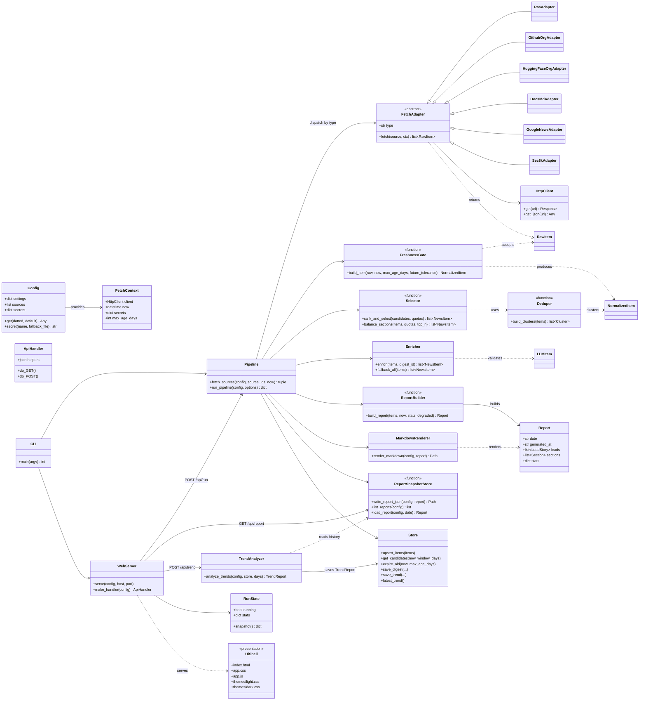

# Pre-Architecture · AI News Agent

> 阶段：Planning Phase（Trace Bullet 已通过验证）
> 日期：2026-11-08
> 约束：Windows / Python 3.12 / **FP64 统一** / HTML 界面 / 外观、配置、主题与核心逻辑分离 / 标准库优先 / SRP / Ubiquitous Language。

---

## 1. Trace Bullet 验证记录

按 Trace Bullet 方法，先打通「**HTML 界面 → HTTP API → 抓取 → 归一化 + 7 天闸门 → 去重排序 → LLM 整理 → 头条 + 三板块报告 → report.json 存为历史数据 → 趋势分析**」这一条端到端垂直切片，再定架构。

| 切片动作 | 结果 |
|---|---|
| `GET /`（HTML 外壳） | 200，`text/html`，1641B，含标题 |
| `GET /static/app.{css,js}`、`/themes/{light,dark}.css` | 全部 200 |
| `GET /api/status` | 200，`{running:false, reports:1}` |
| `GET /api/report/latest` | 200，`leads=5`，`tech 12 / finance 7 / policy 3` |
| `POST /api/run`（限定 4 个源做快速验证） | 202 启动；后台 15s 完成，`sources_ok=4`，抓取 50 条 |
| 运行后 `GET /api/report/latest` | 200，`generated_at` 更新，`leads=5`，`tech 12 / finance 5 / policy 4` |
| `POST /api/trend`（近 7 天） | 200，`status=ok`，输出 981 字趋势分析并落库（`/api/trend/latest` 可读） |
| 单元测试 | 13 项通过（含 FP64 断言、报告结构、板块路由） |

**结论**：切片的每一层都已真实跑通，架构可以按下面的类图落地；“抓取/整理”沿用已验证的管线，“界面/趋势/历史报告”是本轮新增能力。

---

## 2. Ubiquitous Language（统一语言）

| 术语 | 含义 | 实现位置 |
|---|---|---|
| **Source** | 一个信息源（RSS / GitHub org / HF org / docs / 搜索查询 / SEC 公告） | `config/sources.yaml` |
| **NewsItem** | 归一化 + 通过 7 天闸门的新闻条目 | `models.NormalizedItem`、`items` 表 |
| **LeadStory** | 头条：跨板块按重要度排在最前面的条目 | `Report.leads` |
| **Section** | 板块：tech（科技与产品）/ finance（财务与资本）/ policy（政策与监管） | `report.SECTION_META` |
| **Cluster** | 同事件聚类（相似新闻合并） | `dedupe.build_clusters` |
| **Report** | 一次运行产出的日报（头条 + 三板块 + 统计） | `report.build_report`、`digest.md`、`report.json` |
| **ReportSnapshot** | Report 的机器可读快照（历史数据 / 趋势分析的输入） | `out/<date>/report.json` |
| **TrendReport** | 基于全部历史 Report 的趋势分析 | `trend.analyze_trends`、`trend_reports` 表 |
| **Theme** | 界面主题（light / dark），纯 CSS 变量 | `ui/themes/*.css` |
| **Config** | 配置：settings.yaml / sources.yaml / secrets | `config/`、`config.py` |
| **ReportRun** | 一次抓取-整理的运行状态与统计 | `RunState`、`runs` 表 |

> 现存代码/表名沿用 `digest`（历史原因）与 **Report** 同义；后续重命名时以本表为准。

---

## 3. 类图（Mermaid）

---

## 4. 分层与文件映射（外观 / 配置 / 主题 / 核心逻辑分离）

| 层 | 职责 | 文件 |
|---|---|---|
| **Presentation** | HTML 外壳、JS 渲染、CSS 主题；不包含业务逻辑 | `ui/index.html`、`ui/static/app.js`、`ui/static/app.css`、`ui/themes/{light,dark}.css` |
| **Interface (HTTP)** | 只做协议/路由/JSON，调用核心服务 | `src/newsagent/web/server.py` |
| **Application** | 编排：抓取→整理→报告→趋势 | `pipeline.py`、`report.py`、`trend.py` |
| **Domain** | 新闻条目、时效闸门、去重、排序、板块平衡 | `models.py`、`normalize.py`、`dedupe.py`、`select.py`、`enrich.py` |
| **Infrastructure** | 外部渠道、HTTP、SQLite、配置 | `fetch/*`、`http.py`、`store.py`、`config.py` |
| **Configuration** | 运行参数、渠道清单、prompt、主题选择 | `config/settings.yaml`、`config/sources.yaml`、`config/prompts/` |
| **Artifacts** | 报告快照与产出 | `out/<date>/digest.md`、`out/<date>/report.json`、`data/news.db` |

**SRP 落地要点**
- 渠道差异只在 `FetchAdapter` 子类；新增渠道不改管线。
- 报告结构只在 `report.build_report`；Markdown / HTML / JSON 都消费同一 Report 对象。
- 主题只改 CSS 变量；换主题不改一行 Python。
- 趋势分析只依赖 `ReportSnapshot`，不依赖抓取细节。

---

## 5. HTTP 接口（本地界面契约）

| 方法 | 路径 | 说明 |
|---|---|---|
| GET | `/` | HTML 外壳 |
| GET | `/static/*`、`/themes/*` | 静态外观资源 |
| GET | `/api/status` | 运行状态（idle/running/error + stats） |
| GET | `/api/reports` | 历史报告列表（date/item_count/model/degraded） |
| GET | `/api/report/latest` | 最新 Report（leads + sections + stats） |
| GET | `/api/report/<date>` | 指定日期 Report |
| POST | `/api/run` | 后台生成日报（可选 no_llm/top/sources；单任务互斥） |
| POST | `/api/trend` | 基于历史 Report 生成 TrendReport（同步，10–30s） |
| GET | `/api/trend/latest` | 最近一次趋势分析 |

默认监听 `127.0.0.1:8765`（`web.host/port` 可配），仅本机访问、无鉴权。

---

## 6. FP64 统一策略

- Python 的 `float` 即 IEEE-754 binary64（FP64）；本项目所有浮点（score/weight/比例）都用 Python `float`，SQLite 用 `REAL`（双精度），JSON 数字序列化为双精度。
- 不引入 `float32` / `numpy.float32`；若未来接入数值库（如事件研究市场模型），显式使用 `numpy.float64`。
- 单元测试 `tests/test_report_fp64.py` 断言 `sys.float_info.mant_dig == 53`，并校验 Report 中 score 为 FP64。

---

## 7. 已确认决策（2026-11-08）

1. **无人值守每周更新**：用 Windows 任务计划程序每周一 07:30 跑（`scripts/install_schedule.ps1 -DaysOfWeek Monday -Time 07:30`），不需要启动网页；已开启错过补跑（StartWhenAvailable），日志 `logs/auto.log`。
   - **全量刷新**：每次运行重新抓取所有渠道，且不排除历史已展示条目（`digest.full_refresh: true`），报告是当前窗口的完整快照。
   - **邮件推送已停用**（`email.enabled: false`，代码保留可再开）。
   - 注意：**本开发环境的文件沙箱没有创建计划任务的权限**（`New-ScheduledTaskAction` 拒绝访问）；脚本已就绪，需要在你自己机器的普通 PowerShell 里执行一次安装命令。
2. **头条最多 10 条**：按重要度/分数排序取前 10。
3. **相似新闻合并**：在 LLM 整理后新增一次「同事件归并」调用（`config/prompts/merge_v1.md`），保留信息最完整的一条并标注「另有 N 家报道」。
4. **趋势分析**：7 / 14 / 30 天可切换，最近一次结果长期置顶展示；历史输入为全部 `report.json`。
5. **定时/自动**：以任务计划为准；网页端保留手动「生成日报」。
6. **财务/政策只留硬信息**：非官方来源（媒体解读）强制回科技板块；硬信息源包括 SEC 8-K、港交所公告（智谱/MiniMax）、国务院政策文件库、网信办、NIST、EU、DOJ。
7. **分级时效窗口**：科技（新闻）保持 7 天；财务硬信息 30 天；政策硬信息 90 天（政策文件/公告更新慢，7 天内经常没有 AI 政策）。窗口可在 `settings.yaml` 的 `digest.finance_window_days / policy_window_days` 调整。
8. **FP64 范围**：只约束数值计算（score/权重/统计与未来市场模型），文本/ID 不受影响；金额类数据若进 M5，建议金额用 `Decimal` 或整数分，分析分数继续用 FP64。

### 现存待确认（非阻塞）

- **每周自动更新已确认**：每周一 07:30，全量刷新；任务名 `AI News Agent Weekly`（需本机安装一次）。
- **邮件推送已停用**：代码保留，未来可把 `email.enabled` 改回 true 恢复。
- **M5 投资/市场分析暂不启用**：设计已留存 [MARKET_INVESTMENT.md](MARKET_INVESTMENT.md)，需要时打开软件再接入。
- 如需改周几/时间，用 `install_schedule.ps1 -DaysOfWeek <day> -Time <HH:mm>`。
- 如需导出 PDF/飞书推送，可后续补充。
